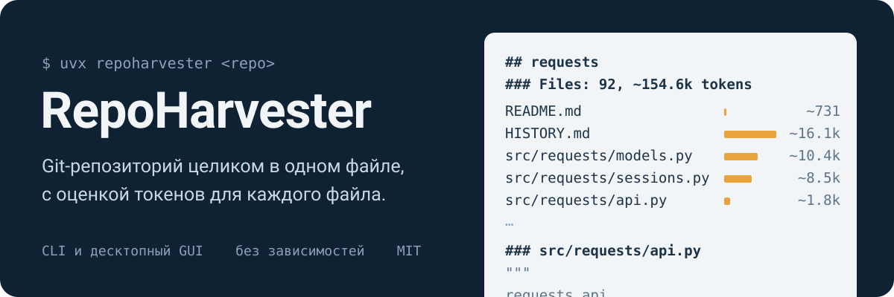
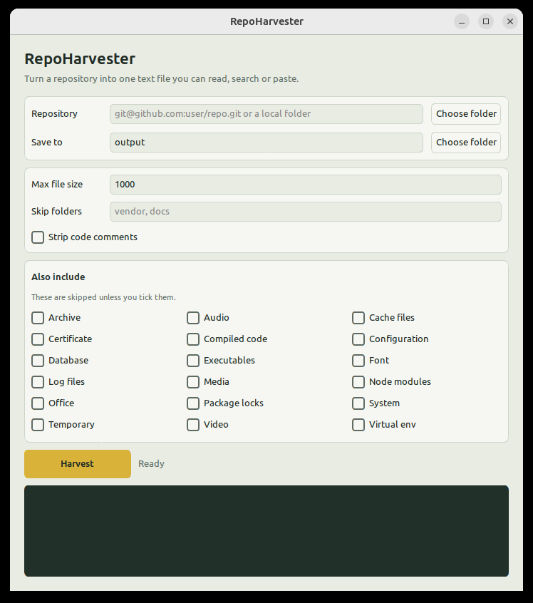

<p align="center">
  
</p>

[](https://github.com/octrow/RepoHarvester/actions/workflows/ci.yml)
[](https://pypi.org/project/repoharvester/)
[](https://pypi.org/project/repoharvester/)
[](LICENSE)

[English](README.md) | **Русский**

Клонирует git-репозиторий (или берёт локальную папку) и собирает все его текстовые файлы в один, который можно сразу вставить в ChatGPT или Claude. Консольная утилита и необязательный GUI, зависимостей нет.

```shell
uvx repoharvester https://github.com/psf/requests
```
```
Cloning https://github.com/psf/requests
Wrote 92 files to output/requests_all_files.txt, ~154.6k tokens (0 non-UTF-8 skipped)
```

## Что получается
`output/requests_all_files.txt` начинается со списка всех файлов с их размером в токенах, дальше идут сами файлы:
```
## requests
### Files: 92, ~154.6k tokens
.coveragerc  ~16
HISTORY.md  ~16.1k
src/requests/models.py  ~10.4k
...

### src/requests/api.py
"""
requests.api
...
### end of file
```
Список показывает модели структуру репозитория, а вам — какие файлы съедают контекст. Токены оценочные (~4 символа на токен). Файлы не в UTF-8 перечислены в `skipped_files.txt` рядом с результатом.

## Возможности
- Принимает SSH/HTTPS-адреса git (неглубокий клон во временную папку) или локальные папки.
- По умолчанию пропускает бинарники и мусор: медиа, архивы, исполняемые файлы, lock-файлы, `node_modules`, виртуальные окружения, кэши, `.git`, `.github` и другое.
- Может удалять комментарии в распространённых языках. Строковые литералы не трогает, так что `"http://..."` и `"#fff"` остаются целыми. Для Python используется настоящий токенизатор, для остальных языков регулярные выражения.
- Учитывает `.gitignore`: в git-репозитории берутся только отслеживаемые файлы и неотслеживаемые, но не игнорируемые.
- Фильтры по маскам (`--include '*.py'`, `--exclude-glob 'tests/*'`), лимит размера на файл и `-o -` для вывода прямо в stdout.

## Установка
Нужны Python 3.12+ и git.

```shell
uv tool install repoharvester            # или: pipx install repoharvester
uv tool install "repoharvester[gui]"     # вместе с GUI
```

## Использование
```shell
repoharvester <repo-url-or-folder> [options]
```

| Опция | Описание |
|---|---|
| `-r`, `--remove` | Удалять комментарии из кода |
| `--no-skip GROUP[,GROUP]` | Включить группы, которые по умолчанию пропускаются (можно повторять) |
| `--max-size KB` | Пропускать файлы больше этого размера (по умолчанию 1000). Файлы больше 500 KB попадают в лог |
| `--exclude DIR[,DIR]` | Имена папок, которые исключаются вместе с содержимым (можно повторять) |
| `--include GLOB[,GLOB]` | Брать только файлы по этим маскам, например `*.py,*.md` (можно повторять) |
| `--exclude-glob GLOB[,GLOB]` | Пропускать файлы по этим маскам, например `tests/*` (можно повторять) |
| `-o`, `--output-dir` | Папка для результата (по умолчанию `output`) или `-`, чтобы печатать в stdout |
| `--log FILE` | Дополнительно писать лог в файл |

Группы: `archive`, `audio`, `cache_files`, `certificate`, `compiled_code`, `configuration`, `database`, `executables`, `font`, `log_files`, `media`, `node_modules`, `office`, `package_locks`, `system`, `temporary`, `video`, `virtual_env`. Подробности в `EXTENSION_GROUPS`, `FILENAME_GROUPS` и `FOLDER_GROUPS` в `repoharvester.py`.

Пример:
```shell
repoharvester git@github.com:username/repo.git -r --no-skip configuration --max-size 250 --exclude vendor,docs

# только Python и Markdown, без тестов, сразу в буфер обмена
repoharvester . --include '*.py,*.md' --exclude-glob 'tests/*' -o - | xclip -selection clipboard   # macOS: | pbcopy
```
Маски сравниваются с путём от корня репозитория или с именем файла; `*` захватывает и `/`, поэтому пишите `test_*.py` или `docs/*` (а не `**/test_*.py` или `docs/`). Вывод в stdout всегда в UTF-8. Они применяются поверх групп и `.gitignore`.

## GUI
```shell
repoharvester-gui                         # после установки с [gui]
uv run --extra gui repoharvester-gui      # из клона репозитория
```



Вставьте git-адрес или выберите папку, отметьте, что ещё включить, нажмите **Harvest** (или Enter), затем **Open file**.
Пока идёт клонирование, кнопка превращается в **Cancel**. Настройки сохраняются в `~/.config/repoharvester/gui.json`.
На Linux проект использует системный Python: в сборках, которые ставит uv, Tk идёт без сглаживания шрифтов.

## Альтернативы
- [repomix](https://github.com/yamadashy/repomix) (Node.js): больше форматов вывода, точный подсчёт токенов, намного больше опций. Берите его, если у вас есть Node и это нужно.
- [gitingest](https://github.com/coderamp-labs/gitingest) (Python): есть ещё сайт, на котором достаточно заменить `hub` на `ingest` в адресе GitHub.
- [files-to-prompt](https://github.com/simonw/files-to-prompt) (Python): работает с локальными файлами и папками, без клонирования.

RepoHarvester — один модуль на стандартной библиотеке: кроме Python и git ничего ставить не нужно, а для тех, кому удобнее мышкой, есть небольшой GUI.

## Разработка
См. [CONTRIBUTING.ru.md](CONTRIBUTING.ru.md).

```shell
uv run --group dev pytest
uvx ruff check .
```

## Лицензия
MIT. См. `LICENSE`.
