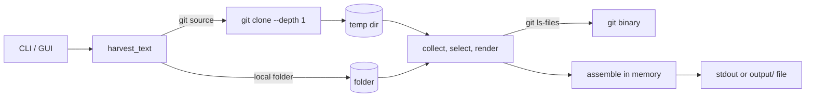

# System design review: RepoHarvester

Kind: local CLI + Tk GUI (library-shaped, no server). Stack, flow and known gaps: [logic-map.md](logic-map.md); not repeated here.

## Assumptions

| Item | Value | Label |
|---|---|---|
| Users | 1 (the owner) | assumed (personal tool, README) |
| Runs/day | 1-200 | assumed (no usage log exists; `output/` is empty) |
| Repo size | 0.1-10 MB text typical, 100 MB+ outlier | assumed |
| Per-file cap | 1000 KB default (`--max-size`) | measured (logic-map step 1/4, code) |
| Code size | 366 + 349 lines, 2 flat modules | measured (`wc -l`) |
| History | 51 commits; 23 on 2026-10-16, 4 more by 2026-11-05 | measured (`git log`) |
| LLM / DB / cache / network | none; only `git` binary | measured (logic-map) |
| Token estimate | `len/4` per section | measured (`repoharvester.py:193`) |

Not measured, deliberately: wall time per run (running the app is out of scope for this review).

## 0. What exists

One process, one thread (GUI: one daemon worker plus the Tk thread). Pipeline `Collect -> Select -> Render -> Assemble -> Write` runs fully in memory inside `harvest_text` (`repoharvester.py:277`). Only external dependency: `git clone --depth 1` (`:264`) and `git ls-files` (`:216`). No server, no queue, no cron, no deploy. Ladder rung today: **rung 1, below it even: a single-process tool on one machine.** Cache, DB, replicas, shards: n/a.

## 1. Requirements

One sentence: turn a git URL or a local folder into one UTF-8 text file sized for LLM context.

- Functional: harvest a repo to a file or stdout; filter by group/glob/size; strip comments; cancel a clone from the GUI. Out of scope: incremental harvest, submodules, remote caching, multi-user.
- Latency: no SLO. Assumed target: under 10 s for a repo up to ~10 MB, dominated by clone.
- Availability: none required; failure is a re-run.
- Consistency: output is a snapshot of the tree at read time; no locking against concurrent edits.
- Durability: output is regenerable. Only invariant: a failed run must not leave a half-written file (see Risks).
- Security: input is an arbitrary URL or path, read-only on the source; the output may contain secrets of the source (see logic-map #1). A hostile repo can shape output size and file count.
- Observability: stderr INFO log plus optional `--log` file. Enough for one user.

## 2. Napkin math

The skill's script is request/DB-shaped, so I used it only for the "heavy personal use" envelope (1 user, 200 runs/day, 5 MB written per run); the memory line comes from a second calculation by script, not a server model.

```
$ napkin.py --dau 1 --req-per-user 200 --object-kb 5000 --response-kb 5000
requests/day ............ 200      peak (x3) ... 0.0 req/s
servers @ 1000 req/s .... 2 (floor of the model; real answer: 0 servers)
storage per day (x3 repl) 120 kB    per year 43.8 MB    after 5 years 219 MB
egress at peak .......... 250 kbit/s
verdict: rungs 1-2: one good VPS. Ship it.
```

Throughput is irrelevant: 200 runs/day is 0.002 runs/s. The one number that moves the design is **peak memory per run**. The whole source is held as `sections` dict, then the joined output string (`:211`), then the `.encode('utf-8')` copy on stdout (`:316`), so roughly 3 copies of the text (assumed ASCII; non-ASCII makes `str` and bytes diverge):

```
 1 MB source ->    3 MB peak,   0.25 M tokens
10 MB source ->   30 MB peak,   2.5 M tokens
100 MB source ->  300 MB peak,  25 M tokens
1000 MB source -> 3000 MB peak, 250 M tokens
```

A 25 M-token output is useless for any LLM context (assumed context window: 0.2-1 M tokens), so the practical ceiling is set by the downstream use, not by RAM, until roughly 1 GB of source.

## 3. API contract

n/a as a service. Public surface: CLI flags (logic-map "Entry points"), and `harvest_text(repo, options, cancel) -> Harvest(name, text, file_count, skipped)` / `harvest(...) -> Path` (`:277`, `:293`). Contract notes that matter at scale: `harvest_text` returns the full text in memory, so library callers inherit the 3x memory figure; no streaming API exists.

## 4. High-level architecture

Rung 1 holds; no new boxes proposed.



Why each box exists: `git clone` is the only way to get remote sources (functional); `git ls-files` implements git-ignore filtering (functional); temp dir isolates the clone and is auto-removed. A queue, worker pool, cache or DB would have no requirement behind it.

## 5. Deep dive: the data

No storage engine. Data = files on disk in, one text file out. Filter tables are in-code sets (`EXTENSION_GROUPS`, `FILENAME_GROUPS`, `FOLDER_GROUPS`). Cache: none, and none needed: a repeat run re-clones, which is the dominant cost and is cheap for a one-user tool. If the same remote repo were harvested often, the cheapest cache is a persistent bare clone keyed by URL plus `git fetch --depth 1`; not justified at current use.

Output file naming is `<name>_all_files.txt` in `output_dir` (`:297`): a collision store of one slot per repo name (logic-map #3).

## 6. Scale and failure

x10 (10x repo size, or 10x runs): runs are independent and serial, so runs/day cost nothing. Repo size x10 first saturates **memory** (3x copies; 100 MB source -> ~300 MB peak, measured by arithmetic above), then the **downstream context window**, long before CPU. Walk and read are single-threaded; for a 10 MB repo this is I/O on page-cached files (assumed sub-second).

| Failure | Behaviour today | Verdict |
|---|---|---|
| Clone hangs (slow or dead remote) | `communicate(timeout=0.2)` loop with a 600 s deadline (`CLONE_TIMEOUT_S`), fixed 2026-11-05 | clone fails with `CloneError` after 600 s; `git ls-files` still has no timeout |
| `git ls-files` hangs | `subprocess.run` without timeout (`:216`) | hangs on e.g. a dead network filesystem root |
| Huge repo | whole text in RAM, no total cap, only per-file cap | OOM possible at multi-GB source |
| Process killed mid-write | fixed 2026-11-05: temp file + `os.replace` (`_write_atomic`) | previous good file survives a failed write |
| File vanishes in walk | `stat` raises `OSError`, run stops (`:163`; logic-map step 4) | acceptable for a snapshot tool, re-run |
| Ctrl+C / window close | git keeps running detached (logic-map #12) | leak, bounded by git finishing |
| Retries, circuit breakers, rate limits | none | n/a: one user, re-run is the retry |
| Backups | n/a: output is regenerable | fine |

The slowest external dependency is the git remote (network + repo size); everything else is local file I/O.

## 7. Trade-offs

- In-memory assembly vs streaming: simple code and an exact token count in the header (needs the total before the first byte) versus 3x RAM. Right for repos that fit an LLM context anyway; the header requirement is what blocks streaming.
- Shallow clone: fast and small versus no history/submodules (intentional; output is a snapshot).
- Fail-open on `git ls-files` errors (logic-map step 5): works outside git repos versus silently harvesting ignored files, including secrets.
- Two flat modules, no package: lowest overhead versus no import-time structure for reuse; fine at 715 lines.
- `len/4` token estimate: free versus +-20-30% error for code and non-Latin text (assumed). Good enough for a sizing hint, wrong for a hard budget.

## 8. Summary

Design in three lines: a single-process pipeline that clones or walks, filters, renders and writes one text file; all state is transient; the only external dependency is `git`. It holds its real load (one user, a handful of repos) with a very large margin. What breaks first at x10 is memory on a very large repo, then the usefulness of the output, not throughput.

Assumptions that would change it: repos in the GB range (then stream and add a total-size cap); harvest used as an unattended service or CI step (then add timeouts and atomic writes); untrusted input URLs (then see security items below).

Next rung and trigger: not a ladder rung. Add a total-size cap plus a streaming write when a run exceeds ~500 MB peak RSS or a harvest exceeds the target model's context (assumed 1 M tokens). Add timeouts the first time it runs unattended.

## Risks

- Fixed 2026-11-05 (`_write_atomic`). Was MEDIUM, `repoharvester.py:297-299`: output written in place with `write_text`; a kill or full disk mid-write destroys the previous good file. Write to a temp file in the same folder, then `os.replace`.
- Partly fixed 2026-11-05: `git clone` has a 600 s deadline (`CLONE_TIMEOUT_S`); `git ls-files` and the `--timeout` flag remain. Was MEDIUM, `repoharvester.py:264-271`, `:216`: no overall timeout on `git clone` or `git ls-files`; an unreachable remote hangs the CLI indefinitely. Add a `--timeout` and pass `timeout=` to `subprocess.run`.
- MEDIUM, `repoharvester.py:174`, `:211`, `:316`: no total size cap and about 3 copies of the text in RAM; per-file cap (1000 KB) bounds a file, not a repo. Add `--max-total-mb` that stops with a clear error before render.
- LOW, `repoharvester.py:216-222`: `ls-files` output is read fully into a `set`; negligible below 100k files. Only matters for monorepos.
- LOW, `repoharvester.py:193`: `len/4` estimate is a hint, not a budget; do not use it to gate LLM calls.
- Referenced from logic-map because they affect failure behaviour at scale: #12 (detached git after Ctrl+C or window close), #3 (output name collision overwrites), #1 (secrets such as `.env` harvested in non-git folders; a safety, not a scale, problem), #6 (`repo` starting with `-` parsed as a git option; matters if the URL ever comes from untrusted input).
- Measured here: nothing time-based. `output/` is empty, no run logs exist, so there is no measured runtime to cite.
